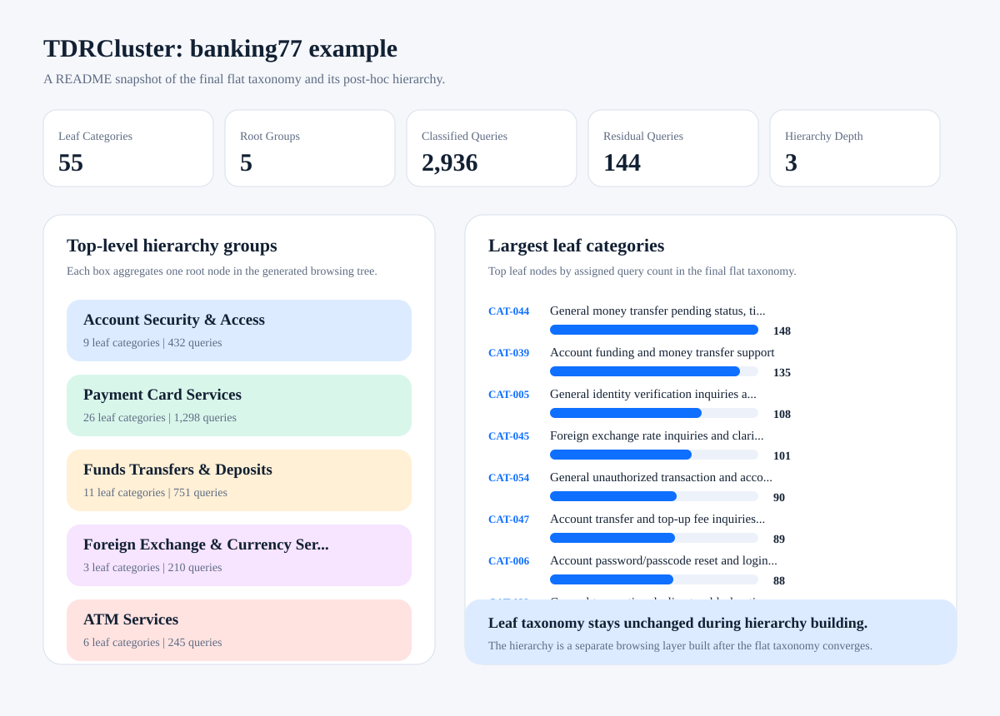

# TDRCluster

Dynamic intent taxonomy induction for unlabeled queries.

TDRCluster 是一个面向无标签文本数据的意图发现项目。它的目标不是把数据强行压进预先设定好的类别数，而是从原始 query 中逐步形成一套稳定、可复用、可解释的 taxonomy。

项目当前采用三段式流程：

- 用 `Embedding + UMAP + HDBSCAN` 完成物理切分与去噪
- 用 LLM 顺序维护 running taxonomy
- 在叶子 taxonomy 收敛后，再生成独立的层级浏览树

这套设计适合客服日志、搜索 query、工单、对话记录等场景，尤其适合“类别尚未定义清楚，但希望先看到真实意图结构”的任务。

## Overview

传统聚类方案通常会遇到几个问题：需要预先指定类别数、容易被噪声拖偏、以及在大簇上直接让模型判断时缺乏足够证据。TDRCluster 的思路是先把几何问题和语义问题拆开，再让 taxonomy 在流程中逐步收敛。

在当前版本中：

- 物理切分负责把大规模原始数据分解为纯度更高的 micro-clusters
- LLM 只负责语义裁决，而不负责猜测聚类参数
- hierarchy 被放在后处理阶段，不会反向影响叶子分类结果

## Highlights

- No predefined category count
  类别数量和粒度不需要预先指定，由数据分布与语义收敛过程自然形成。

- Running taxonomy
  系统不是一次性生成全部标签，而是在处理过程中持续维护已有类别，并对新证据做 `create / merge / split / inspect` 决策。

- Noise-aware physical split
  噪声点和不稳定簇会被显式剥离，避免在早期就污染 taxonomy。

- Evidence-driven review
  Reviewer 看到的不是单一中心样本，而是混合采样后的代表样本、差异样本和边界样本。

- Post-hoc hierarchy
  最终层级树是独立生成的浏览结构，不改动叶子 taxonomy。

## Example: banking77

下面这张图来自当前仓库内保留的一次 `banking77` 完整运行结果。它同时展示了最终 flat taxonomy 的规模，以及 post-hoc hierarchy 的顶层结构。



这一版结果中：

- 形成了 55 个叶子类别
- 后处理层级树包含 5 个顶层语义组，最大深度为 3
- `NMI_classified = 0.8923`
- `NMI_full = 0.8650`

## How It Works

### 1. Physical partitioning

系统先为原始 query 生成 embedding，再通过 `UMAP + HDBSCAN` 将数据切分为多个 micro-clusters。目标不是直接给出最终标签，而是生成一批更适合语义审查的高纯度候选簇。

### 2. Semantic convergence

每个 micro-cluster 会被按顺序送入 reviewer。LLM 基于当前 running taxonomy 做出以下决策之一：

- `create`
- `merge`
- `split`
- `inspect`

其中 `inspect` 用于请求额外证据。当当前样本不足以可靠判断时，系统会继续补充一轮未见样本，再进入下一次审查。

### 3. Hierarchy building

当 flat leaf taxonomy 已经形成后，可以再调用 hierarchy builder，把已有叶子类组织成一棵更适合浏览的语义树。这个阶段不会重命名、拆分、合并或删除任何叶子类别。

## Design Principles

- Leaf taxonomy is the source of truth
- Hierarchy is a view, not a rewrite
- Physical split and semantic judgment should be separated
- Merge should be allowed to refine category boundaries

这几条原则基本定义了当前版本的边界。

## Quick Start

```bash
git clone https://github.com/harooos/TDRCluster.git
cd TDRCluster
pip install -r requirements.txt
cp config/config.example.yaml config/config.yaml
```

然后：

1. 在 `config/config.yaml` 中填写 LLM 与 embedding 配置
2. 将原始数据放入 `data/raw_data/`
3. 支持 `CSV` 和 `Excel` 输入，文件至少包含 `query` 列
4. 运行主流程

```bash
python main.py
```

如果需要层级化结果：

```bash
python build_hierarchy.py output/<summary_json>
```

## Outputs

主流程通常会生成：

- `output/<dataset>_clustering_<timestamp>.csv`
- `output/<dataset>_summary_<timestamp>.json`

层级化流程会额外生成：

- `output/<dataset>_hierarchy_<timestamp>.json`

其中：

- `clustering.csv` 记录 query 到叶子类别的映射
- `summary.json` 记录最终 flat taxonomy 与 residual 信息
- `hierarchy.json` 记录 post-hoc 生成的层级树

原始输入可以是：

- `data/raw_data/<dataset>.csv`
- `data/raw_data/<dataset>.xlsx`
- `data/raw_data/<dataset>.xlsm`
- `data/raw_data/<dataset>.xls`

## Configuration

仓库跟踪的配置模板为：

- `config/config.example.yaml`

本地运行时使用：

- `config/config.yaml`

当前实现支持：

- OpenAI-compatible LLM endpoint
- `openai` 或 `ark_multimodal` 风格的 embedding 接口

## Benchmark Snapshot

当前版本在 `banking77` 上的一次完整运行结果中，得到：

- `NMI_classified = 0.8923`
- `NMI_full = 0.8650`

仓库目录中保留了一版对应输出：

- `output/banking77_summary_20260311_230022.json`
- `output/banking77_hierarchy_20260312_000101.json`

## Use Cases

TDRCluster 适合以下场景：

- 客服意图发现
- 搜索 query 聚类
- 工单主题归纳
- 对话日志中的用户需求结构分析
- 标注体系建立前的探索性 taxonomy induction

如果你的目标是从无标签 query 中得到一套尽量稳定、可解释、可扩展的类别结构，而不是只跑一次静态聚类，这个项目就是为此设计的。
